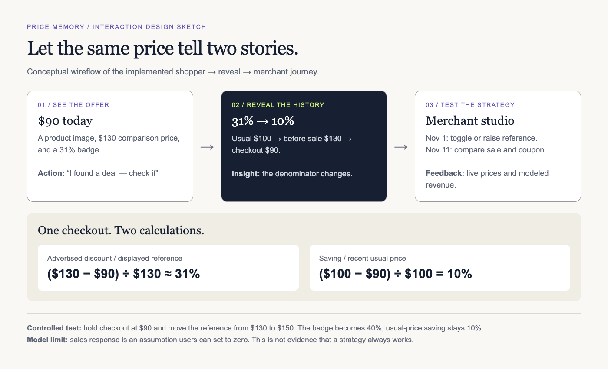
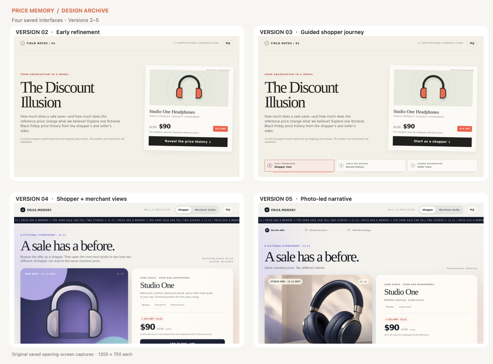
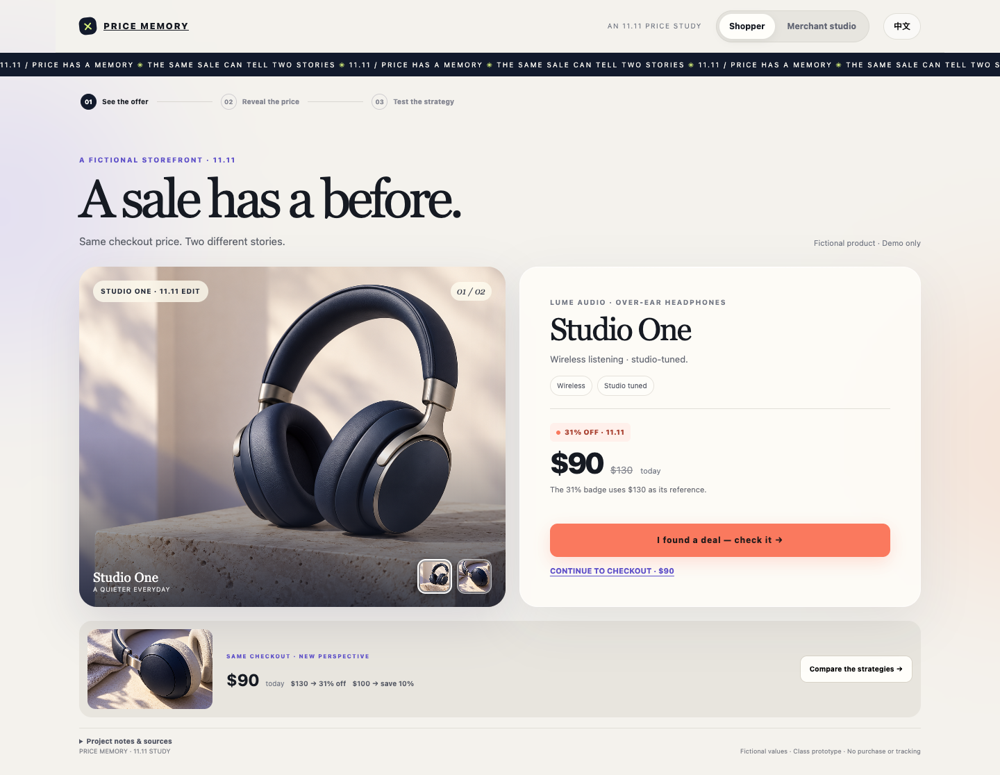
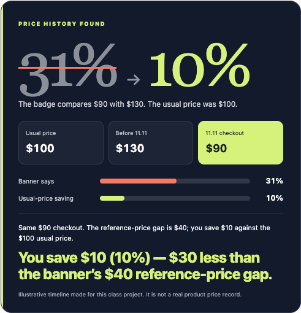
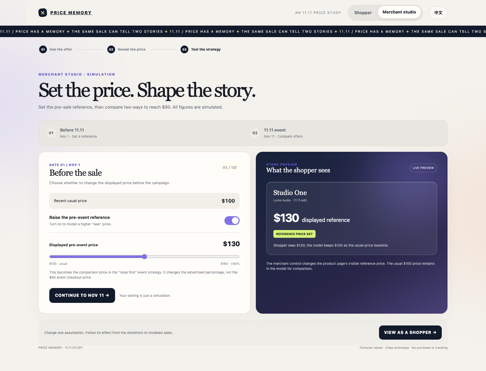
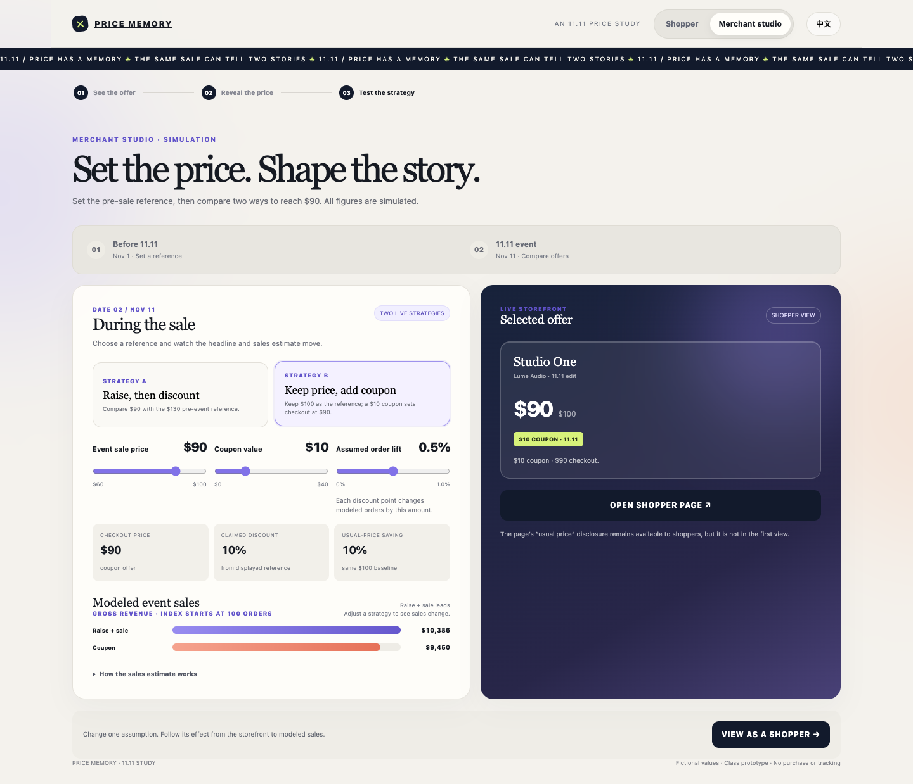
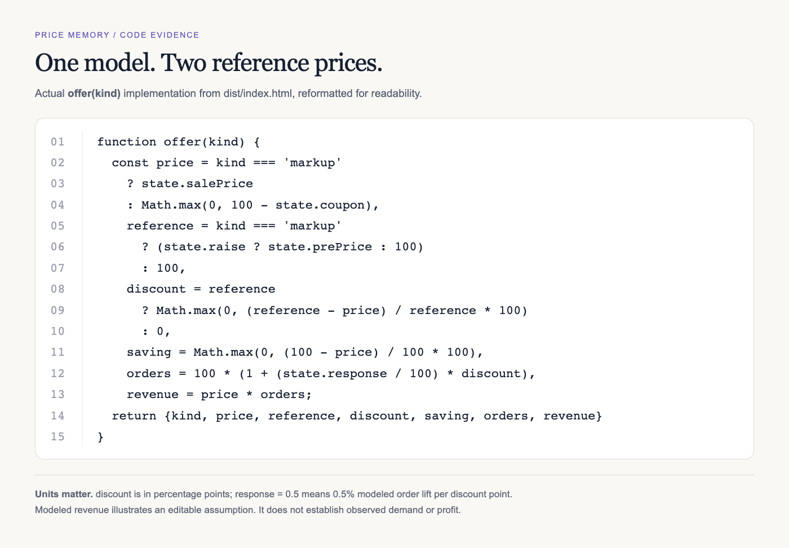

# Price Memory · The Discount Illusion

How does a reference price shape the discount a shopper believes they are getting?

Interactive prototype: Price Memory · The 11.11 Study

## Step 1: Observe a phenomenon

In my shopping experience over recent years, I have sometimes noticed a familiar sale pattern: a product is presented with a large “was” price and a lower holiday price. That observation led me to ask: How does the reference price shape the discount a shopper believes they are getting? I am treating this as a question to investigate, not as proof that every merchant raises prices before a sale.

The prototype uses one fictional pair of headphones. Its recent usual price is $100, its displayed comparison price rises to $130, and its sale price is $90. The banner calculates (reference price − sale price) ÷ reference price, so it advertises 31% off. Comparing the same $90 checkout price with the recent $100 price gives 10% savings. The shopper pays the same amount in either comparison; what changes is the story the percentage tells. All product names and prices in the prototype are invented teaching values, not a real product’s history.

### Design sketch, prototype, and code

### Low-fidelity interaction sketch — fictional example

The first product card emphasizes the sale claim. The reveal panel compares it with the $100 usual price. Merchant studio separates the two dates and offers a pre-event price control, then compares a raise-then-sale strategy with a coupon strategy. The chart uses an explicitly stated response assumption. Supporting explanation also appears lower on the shopper page.

### Interface evolution — versions 2–5

Four saved screens: the early shopper concept, a guided reveal, the two-view storefront, and the photo-led story. Version 1 is excluded from this comparison and remains archived separately.

Source code file: [HTML / CSS / JavaScript prototype](https://drive.google.com/file/d/1a4W_WcS76it41ZatnBs4IzKXbLiKBCcb/view)

## Step 2: Apply computational thinking

I decomposed the shopping event into a product, a time, a recent usual price, a displayed reference price, a coupon, a final price, an advertised discount, and a possible purchase response. Looking for a pattern revealed that, when the final price stays fixed, changing the reference price changes the advertised percentage without changing the dollars saved against the recent usual price. I abstracted the situation to one product and one price timeline. This keeps the comparison understandable while leaving out product quality, taxes, inventory, costs, retailer differences, and observed shopper behavior.

The seller model compares a price increase with a coupon using two campaign dates. The shopper page shows the campaign price first and reveals the usual $100 price on request. The model starts at a $90 checkout price, while allowing users to adjust the pre-event reference, event price, coupon, and assumed response lift. Its toy algorithm is:

headline_discount_percent = max(0, (reference_price - checkout_price) / reference_price * 100)

actual_saving_percent = max(0, (usual_price - checkout_price) / usual_price * 100)

modeled_orders = 100 * (1 + response_lift_percent / 100 * headline_discount_percent)

modeled_gross_revenue = modeled_orders * checkout_price

The model starts with 100 hypothetical orders and uses an editable response assumption. For example, a response lift of 0.5% means that each one-percentage-point increase in the advertised discount adds 0.5% to modeled orders. This is a deliberately simple assumption, not measured consumer behavior. The output is gross revenue, not profit; calculating profit would require costs and other business data.

## Step 3: Use AI to support thinking

My prompt (translated from Chinese): “I have noticed a possible raise-before-sale pattern around Black Friday. Could I make this an interactive project, and how could it show both the shopper’s and seller’s point of view?”

AI response (paraphrased): The AI suggested reframing the topic as “How real is a Black Friday discount?” It proposed a fictional headphone example: a recent usual price of $100, a displayed reference price of $130, and a sale price of $90. That makes the banner’s discount about 31%, while the reduction from $100 is 10%. It also suggested revealing the price history and making a small interactive comparison.

How I used the response: I kept the example as invented teaching data and used its arithmetic to shape the prototype. I did not treat the AI’s example as an observed product or as evidence that all merchants use this strategy.

My judgment mattered at each step. I separated the page’s comparison price from the recent usual price so the model could show both calculations. I narrowed the claim from “merchants raise prices” to a question about how reference prices shape perceived savings, since my own observation is anecdotal and the AI scenario is fictional. I also made the seller’s demand response adjustable and labeled it an assumption. AI helped me decompose the idea and propose a pattern to test; it could not provide my missing price records, establish intent, or decide what comparison is fair.

Iteration and human decisions: I then asked for a merchant view with two dates, a price-increase option, a coupon alternative, and a sales chart; later I requested less text, more product imagery, clearer feedback, and a stronger discovery sequence. These are summaries of my prompts, not a fabricated transcript. AI supported the model structure and implementation, while I evaluated whether the experience actually communicated the idea. The retained version comparison records that iteration.

## Critical check: I treated the demand response as an editable hypothesis. Setting response to zero challenges the seller model; holding checkout fixed tests the discount claim. The AI’s fictional example cannot establish prevalence, merchant intent, or shopper impulsiveness.

## Step 4: Represent the phenomenon in code

### Prototype and source

Price Memory · The 11.11 Study is a bilingual HTML/CSS/JavaScript prototype. The controls connect a shopper’s promotion card with a merchant’s two-date campaign model.

Live prototype:[ https://discount-illusion-study.yatagarasu686.chatgpt.site](https://discount-illusion-study.yatagarasu686.chatgpt.site)

The hosted preview currently requires the owner’s access. For review without that access, the standalone HTML contains the complete interaction and embedded product images; download it and open it in a browser.

### Interaction 1 — Encounter the offer

The product card foregrounds the headphones, $90 checkout price, and 31% off badge. A familiar shopping layout makes the reference-price framing recognizable before the user examines the calculation.

### Interaction 2 — Reveal the comparison

Selecting the price-memory reveal exposes the $100 usual price and the $10 / 10% saving. The payment stays $90: the surprise comes from changing the comparison, not from changing the purchase. The reveal makes the missing denominator concrete.

### Interaction 3 — Construct the reference

In Merchant studio, select Before 11.11, turn the price increase on or off, and adjust the displayed reference. The product preview updates immediately. Separating the two dates communicates when the merchant changes the reference and when the shopper encounters the promotion.

### Interaction 4 — Compare campaign strategies

Select 11.11 and compare Raise + sale with Usual price + coupon. The chart updates modeled gross sales, while the product preview shows the selected offer. At the defaults both strategies charge $90, but their advertised percentages differ. Revenue depends on the adjustable response assumption; it is not measured demand or profit.

### Interaction 5 — Check the alternative

The coupon view keeps the $100 baseline and subtracts a $10 coupon. Showing this alternative lets the user compare equivalent checkout prices rather than assume that the larger badge is necessarily a better deal.

### Code and state

The offer(kind) function below is extracted from the actual prototype, with whitespace adjusted for readability. Shared state stores role, campaign date, reference price, sale price, coupon, response, and reveal status. Price controls recalculate the offer; rendering updates the product, labels, chart, and comparison together.

### Testing and iteration

The final checks held checkout at $90 and the usual price at $100 while changing the reference from $130 to $150: the claim moved from 31% to 40%, while effective savings remained 10%. With response set to zero, both $90 strategies produced $9,000 modeled gross sales. The code retains unrounded percentages for calculation and rounds only display labels.

Testing also exposed stale default-value captions and an incorrect winner label when modeled revenue tied. These were corrected so explanatory text follows the controls and equal outcomes read “Same modeled sales.” Desktop interaction, mobile overflow, the reveal, image loading, and Chinese labels were checked. These are functional checks, not evidence from a formal usability study.

The saved versions 2–5 comparison above documents the progression toward a product-led interface. My critique of earlier iterations was that explaining the idea with more text did not make the discovery easier. The current sequence uses a recognizable offer, an explicit reveal, and manipulable controls. A remaining design question is whether supporting explanations lower on the page disclose the answer too early; this should be tested with first-time users.

## Step 5: Reflect on how computational thinking helped

Decomposition helped me stop treating “a discount” as one fact. I separated the usual price, displayed reference price, checkout price, percentage claim, and dollars saved. Once these had different names and roles, I could ask which quantity was changing. A larger percentage could now be explained by its denominator even when the shopper’s payment stayed constant.

Pattern recognition became a controlled comparison. Holding the usual price at $100 and checkout at $90, I could change the reference from $100 to $130 to $150. The headline becomes 10%, about 31%, and 40%, while the saving against $100 remains $10. This invariant gave the interaction a purpose: users can test which apparent changes actually affect their purchase.

Abstraction made the phenomenon manageable, but also exposed the limits of my representation. One fictional product, an immediate coupon, and two campaign dates leave out costs, competition, shipping, coupon eligibility, product variants, and personal need. The current controls also keep checkout at or below the $100 usual price, so the model cannot demonstrate a promotion that costs more than the usual price. Choosing $100 as the baseline is part of the model, not something code proves to be universally fair.

Algorithmic thinking forced me to distinguish an arithmetic result from a behavioral hypothesis. The discount calculation follows from the prices. The seller’s revenue advantage follows only if the assumed response to the headline is positive. Setting that response to zero produces equal modeled orders and revenue for equal checkout prices. That test changed my claim from “this tactic benefits merchants” to “this mechanism could create an incentive under specified assumptions.”

Building and testing the representation also changed how I judge clarity. A working slider is insufficient if its explanation remains stuck on the default example. Keeping state, calculation, and labels consistent is part of communicating the idea truthfully. My next investigation would collect dated prices for the same product and variant, then test how people interpret an offer before and after seeing its history. Computational thinking helped me formulate those tests; it did not replace the missing evidence.

## Background evidence: Which?’s 2024 study found 92% of the selected Black Friday deals at eight UK retailers cost the same or less at other times of year. A 2026 European Commission sweep found 30% of checked traders used incorrect discount references. These limited samples motivate investigation; they do not establish intent or prevalence for this prototype. FTC pricing guidance provides U.S. context.

## Sources

[Which? — 2024 Black Friday pricing investigation](https://www.which.co.uk/policy-and-insight/article/nine-in-10-black-friday-deals-cheaper-or-same-price-at-other-times-of-the-year-which-finds-a4Z2J3u5lTI2)

[U.S. Federal Trade Commission — Guides Against Deceptive Pricing, 16 CFR Part 233](https://www.ecfr.gov/current/title-16/chapter-I/subchapter-B/part-233)

[European Commission — 2026 EU Black Friday/Cyber Monday sweep](https://commission.europa.eu/news-and-media/news/eu-check-reveals-misleading-sales-practices-online-2026-03-26_en)
